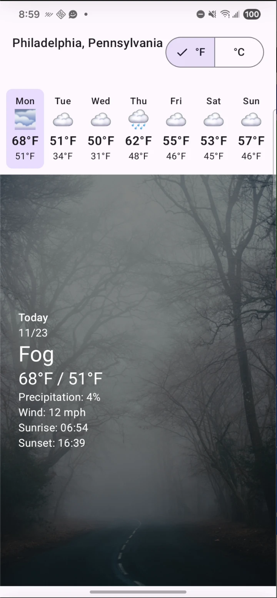
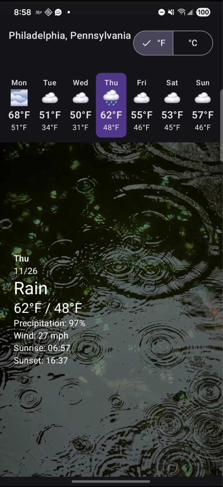

# Skyglance

A Compose Multiplatform app showing a seven-day forecast for your current location.

## Getting Started

1. Open the project root in Android Studio (Ladybug or newer).
2. Point **Settings → Build, Execution, Deployment → Build Tools → Gradle → Gradle JDK** at JBR (bundled with Android Studio) or JDK 21 — Gradle 8.14.3 only supports up to JDK 24.
3. Run the `composeApp` configuration on an emulator or device with Google Play services installed (required for location).
4. Grant the location permission when prompted — without it, the app has no forecast to show.

Command line equivalent:

```bash
./gradlew :composeApp:installDebug
```

iOS target compiles (`:composeApp:compileKotlinIosSimulatorArm64`) but location is stubbed as unsupported — see [Tech Stack](#tech-stack).

## Tech Stack

Skyglance is a Kotlin Multiplatform project split into a `shared` module (repository, caching, networking, domain models — no Compose) and `composeApp` (Compose Multiplatform UI, ViewModel, Android entry point), so everything but the Android-only location permission flow is already written once for both platforms. A single cache-first `ForecastRepository` fetches from Open-Meteo (forecast) and BigDataCloud (reverse geocoding) over Ktor, maps the columnar response into `Forecast`/`DayForecast` domain models, and persists the result via `multiplatform-settings`; the UI observes that cache as a `Flow` and treats a failed refresh as "keep showing what I have, with a stale banner" rather than an error state. Koin wires it all together, and the ViewModel is a thin state machine combining the cached forecast, the last refresh outcome, the temperature-unit preference and the selected day into one `ForecastUiState`.

## UX

 

- Tap a day in the top row, or swipe the detail pane, to switch days — both are the same `selectedIndex`, so they stay in sync.
- The °F/°C toggle is a pure display conversion: it never triggers a refetch, and the cache always stores Celsius.
- A stale, cached forecast is still shown (with a "couldn't refresh" banner) rather than going blank — see the "Today" mislabeling bug below for why that required a real fix, not just a UI banner.
- Preview screenshots for every widget and screen state (light/dark, edge cases like null extras, 6-day forecasts, long place names) live in `composeApp/src/androidMain/kotlin/com/skyglance/ui/preview/`, viewable in Android Studio's Compose Preview pane. *(Possible follow-up: Paparazzi or AGP's Compose Preview Screenshot Testing could publish these as a browsable page via GitHub Actions — not done yet; see Improvements.)*

## Improvements

**App Quality/Stability**
- Firebase Crashlytics, to catch crashes that don't show up in the limited local testing this project got.
- Instrumented tests to surface Koin DI wiring mistakes (a missing binding) at build time rather than at runtime.
- A Paparazzi or Compose Preview Screenshot Testing pipeline, publishing preview renders (see UX above) somewhere browsable in CI, plus regression protection against unintended visual changes.

**Monetization**
- Authentication, if saved locations or cross-device sync are ever added.
- Advertising (e.g. a banner between the forecast and detail pane).
- Premium subscription / IAP support via RevenueCat (e.g. extended forecast range, multiple saved locations).

**Marketing**
- A real iOS location implementation, as a fast follow, would let us distribute to many more potential users.

## Topics for discussion

- **[Repository API](shared/src/commonMain/kotlin/com/skyglance/data/ForecastRepositoryImpl.kt): one data flow, or data and refresh outcome merged?**<br>
  I considered folding the cached forecast and the refresh result into a single flow instead of exposing them separately. Kept them apart because the cache is durable state that should replay to late subscribers, while a refresh outcome is a one-shot event that shouldn't replay or force a nullable `Forecast` back into the API.
- **[AGP/Gradle version](gradle/libs.versions.toml#L11) forces a specific Gradle JDK.**<br>
  I stuck with a proven AGP 8.13.2/Gradle 8.14.3 pairing for Compose Multiplatform used on previous projects rather than an unverified AGP 9 split. This meant pinning `androidx.lifecycle:lifecycle-viewmodel` to 2.9.6 (2.10+ needs AGP 9.1+/compileSdk 37). It also means Android Studio's Gradle JDK setting has to point at JDK ≤24 (JBR or Corretto 21), since Gradle 8.14.3 doesn't support newer ones.
- **[Open-Meteo's response](shared/src/commonMain/kotlin/com/skyglance/data/mapper/ForecastMapper.kt#L33) is columnar, not row-oriented.**<br>
  The `daily` block is several parallel arrays sharing a common index rather than a list of per-day objects, which is typical for time-series/scientific APIs and columnar storage — it mirrors how the backend likely stores the data and avoids repeating key names per record. The tradeoff is that every client has to "zip" the arrays back into per-day records itself, and the format is silently fragile if the arrays ever disagree in length, which is why the mapper computes a shared prefix instead of assuming they match.
- **Bug found during review: a [stale cache](shared/src/commonMain/kotlin/com/skyglance/domain/Forecast.kt#L26) could mislabel old data as "[Today](composeApp/src/commonMain/kotlin/com/skyglance/ui/format/Formatting.kt#L11)".**<br>
  The cache had no expiration check and the UI labeled the first day "Today" by list position rather than by date, so an app reopened after days unused with a failing refresh would confidently show week-old dates as current instead of just stale. Fixed by comparing each day's real date against the actual current date for the "Today" label, and by treating a cached forecast whose last day has already passed as equivalent to no cache at all.
- **Order of implementation: UI before data.**<br>
  Building and reviewing the UI against hard-coded preview data first helped later phases, like the network data mapping, go much smoother.
